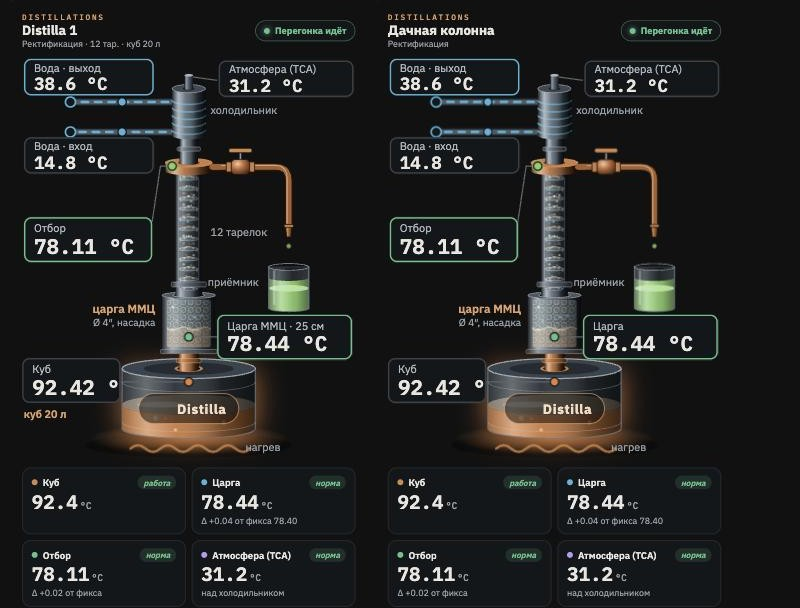

# Distilla Card

Карточка для Home Assistant под Telegram-термометр **Distilla 1**. Внутри та же анимированная схема аппарата, что и в веб-интерфейсе прошивки: колонна, пар, капли отбора, вода в холодильнике, нагрев куба. Значения на схеме живые, а рамки подсвечиваются по состоянию: норма, внимание, не норма.



**Что есть в карточке:**
- **Схема аппарата.** Подписаны куб, царга, отбор, атмосфера (ТСА), вода на входе и выходе.
- **Плитки.** Дельта царги и отбора от фикса, атмосфера, вода: вход, выход, нагрев, расход, литры за перегон.
- **Строка состояния.** Давление, температура корпуса, батарея, Wi-Fi, связь с Телеграмом, версия прошивки.
- **Статус в шапке.** «Перегонка идёт», «Ожидание» или название тревоги. При тревоге рамка карточки мигает красным.
- **Анимация по состоянию.** Пока перегонка не идёт, анимация замирает. Когда пропадает вода, останавливается и поток в холодильнике.
- **Кнопки.** Фикс, Заглушить и СТОП. СТОП срабатывает со второго нажатия.
- **История.** Нажатие на любое значение открывает историю этого датчика.

> **Включить нагрев из Home Assistant нельзя, и это сделано специально.** Нагрев включается только руками.
>
> Если тэн подключён через умное реле, пакет `distilla.yaml` умеет его **выключать**: при горячей атмосфере, пропаже воды, срабатывании защиты, по СТОП и когда Distilla пропала со связи. Замените `switch.ten` в автоматизации «Distilla — выключить тэн» на своё реле.

## Что нужно

1. Distilla 1 с прошивкой 1.16 или новее, подключённая к домашнему Wi-Fi.
2. Пакет датчиков [`distilla.yaml`](https://github.com/distilnations/distilla-card/blob/main/distilla.yaml) в папке `/config/packages/` Home Assistant. Замените в нём `192.168.1.50` на IP своей Distilla. Как подключить папку packages, написано в начале файла и в пошаговой инструкции https://distilla.site/ha
3. Home Assistant 2024.8 или новее.

## Установка через HACS

1. HACS → ⋮ → **Пользовательские репозитории** (Custom repositories).
2. Вставьте адрес `https://github.com/distilnations/distilla-card`, тип **Dashboard** (раньше назывался Lovelace / Plugin).
3. Найдите **Distilla Card** → «Скачать», затем обновите страницу браузера.

## Установка вручную

1. Скопируйте `distilla-card.js` в папку `/config/www/`.
2. «Настройки» → «Панели» → ⋮ → «Ресурсы» → «Добавить ресурс».
   - Адрес: `/local/distilla-card.js`
   - Тип: «Модуль JavaScript».
3. Обновите страницу браузера.

## Добавление на панель

«Обзор» → ✏️ → «Добавить карточку». Найдите **Distilla 1** в списке или вставьте вручную:

```yaml
type: custom:distilla-card
title: Distilla 1
plates: 12            # необязательно: подпись «12 тарелок» на схеме
cube_volume: 20       # необязательно: подпись «куб 20 л»
tsarga_label: Царга ММЦ · 25 см   # необязательно
```

### Все настройки

| Ключ | По умолчанию | Что делает |
|---|---|---|
| `title` | `Distilla 1` | Название в шапке |
| `plates` | — | Число тарелок, подпись на схеме |
| `cube_volume` | — | Объём куба в литрах, подпись на схеме |
| `tsarga_label` | `Царга` | Подпись рамки царги на схеме |
| `show_tiles` | `true` | Плитки под схемой |
| `show_buttons` | `true` | Кнопки Фикс / Заглушить / СТОП |
| `entities` | см. ниже | Свои имена датчиков, если вы их переименовали |

Карточка сама находит датчики из пакета `distilla.yaml` (`sensor.distilla_kub`, `sensor.distilla_tsarga` и т. д.). Если у вас две Distilla или датчики переименованы, укажите свои имена:

```yaml
type: custom:distilla-card
title: Дачная колонна
entities:
  cube: sensor.dacha_kub
  tsarga: sensor.dacha_tsarga
  run: binary_sensor.dacha_peregonka_idet
```

Ключи `entities`:
- **Температуры:** `cube`, `tsarga`, `otbor`, `atm`, `win`, `wout`.
- **Фикс и дельты:** `fix`, `dts`, `dot`, `ts_state`, `ot_state`.
- **Вода:** `flow`, `water`.
- **Устройство и служебное:** `pressure`, `battery`, `box`, `rssi`, `mode`, `fw`.
- **Состояния и тревоги:** `run`, `delta_alarm`, `atm_alarm`, `water_alarm`, `heater_cut`, `tg`.

Кнопки вызывают `rest_command.distilla_fix`, `rest_command.distilla_ack` и `rest_command.distilla_stop` из того же пакета.

## Для разработчика

- Карточка собирается из `src/card.template.js` и `src/apparatus.svg` командой `python3 build.py`.
- `test/index.html` — тестовая страница с поддельными данными Home Assistant и кнопками для тревог.

Вопросы и баги пишите на форум https://distilla.site/forum
